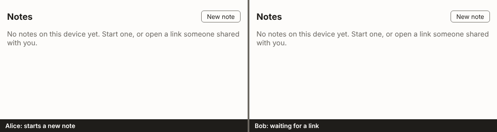

# crdt-notes

A local-first collaborative markdown notes app. Every client works fully offline and
syncs conflict-free on reconnect. The list CRDT (Conflict-free Replicated Data Type)
behind it is implemented from scratch in this repo.

Run it locally with `pnpm dev:server` and `pnpm dev:web`. `pnpm e2e` runs the browser
tests, and `pnpm demo` records the GIF above again (it needs ffmpeg).

- [Roadmap](docs/roadmap.md): phases and their exit criteria
- [CRDT design](docs/crdt-design.md): the writeup
- [Testing strategy](docs/testing-strategy.md): properties P1–P9
- [Decisions](docs/decisions/): ADRs (Architecture Decision Records)
- [Learning log](docs/learning-log.md)
